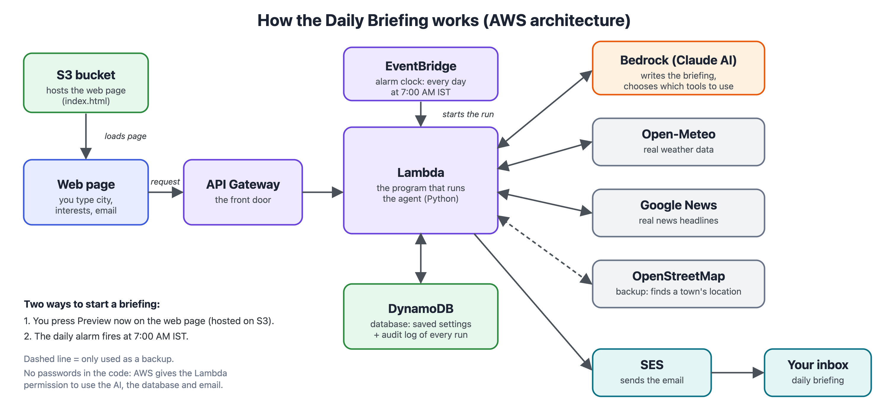
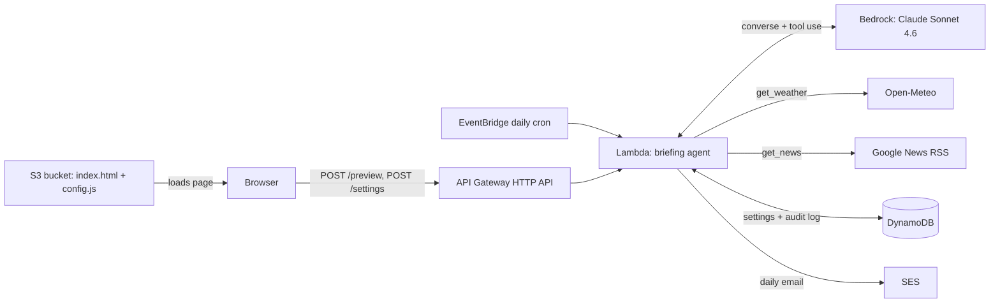
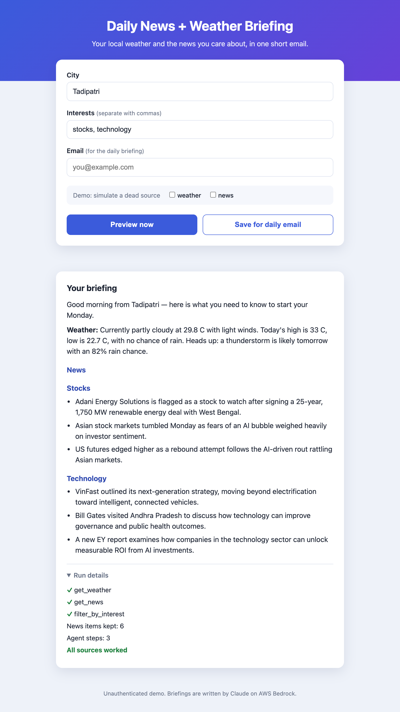

# Daily News + Weather Briefing

An AWS agent that emails a short morning briefing: real local weather plus news on your interests, grouped by interest. A web page (hosted on S3) lets you set your city, interests and email, and has a **Preview now** button that shows the briefing immediately, with a **Run details** box (tools used, items kept, skipped sources).

Spec: [`docs/project-spec.md`](docs/project-spec.md) · Owner: Siva Yerasi · Repo: https://github.com/sivayerasi/news-weather-briefing

## How it works



The same picture as a GitHub-rendered diagram:



One Lambda (Python 3.13) runs a single-agent loop with Bedrock `converse()`. Claude calls three tools:

| Tool | What it does | Source |
|---|---|---|
| `get_weather(city)` | Current conditions and a 3-day forecast | Open-Meteo (real) |
| `get_news(topics)` | Up to 3 recent headlines per topic (last 24 hours), newest first | Google News RSS (real, no API key) |
| `filter_by_interest(items, interests)` | Keeps items that match an interest | Keyword match |

Then Claude writes the briefing: a greeting, a weather paragraph, and a news section with one heading per interest.

Inside one run, the Lambda code and the AI take turns. The AI asks for a tool, the code runs it and sends the result back, and this repeats (at most 6 rounds) until the AI writes the briefing:


**Behavior worth knowing**
- **City lookup:** Open-Meteo first, then OpenStreetMap Nominatim for spellings it misses (for example Tadipatri is stored as Tadpatri).
- **News edition:** picked from the city's country (an Indian city gets the India edition), with the US edition as a fallback.
- **News retry:** if a topic's request fails or comes back empty, it is retried once after a short pause.
- **Interests:** separate with commas. Words without a comma count as one interest, so `stock market` stays one interest. The page warns if you type several words with no comma.
- **Email:** sent as HTML (bold headings, bullet lists) with a plain-text fallback.
- **Page hosting:** the web page (`web/index.html`) is hosted on S3 (static website hosting). A generated `config.js` tells the page the API address, and the API allows only that S3 address through CORS.
- **Settings:** one saved setting per email address. Saving again with the same email overwrites it.

## Reliability and guardrails

| Pattern | What it does | Where |
|---|---|---|
| Max iterations | The agent loop stops after 6 model calls (a normal run uses 3). If it never finishes, the briefing says it could not be completed. | `agent.py` `MAX_ITERATIONS` |
| Error recovery | Tools return `unavailable: true` instead of raising. The agent skips that source, and code adds "Weather/News unavailable today" if the model omits it. One failed topic or one failed user does not stop the rest. | `tools.py`, `agent.py`, `handler.py` |
| Input guardrail | City: letters and simple punctuation, up to 80 characters. Interests: 1 to 10, up to 40 characters each, no special symbols. Email must look valid. Bad input gets HTTP 400 and the model is never called. News text is treated as data, not instructions. | `guardrails.py`, system prompt |
| Output guardrail | Credential-like text (AWS keys, `password=...`, long random strings) is replaced with `[redacted]` before display or email. | `guardrails.scrub_output` |
| Audit log | Every run writes one DynamoDB row: trigger, city, interests, tools called and whether each worked, items kept, unavailable sources, agent steps, email status and the briefing. Rows expire after 90 days. | `store.py` |

A real sample row is in [`docs/audit-log-sample.json`](docs/audit-log-sample.json). It is from the daily-email code path, triggered by hand, with the email address masked.

To demo a dead source, tick "weather" or "news" under "Demo: simulate a dead source" on the page, then press Preview now.

## Screenshots

Normal briefing, all sources worked:



Weather source skipped (simulated). The briefing still arrives with "Weather unavailable today":


## API

The page is served from S3 (the `SiteUrl` stack output) and calls the API (the `ApiUrl` output). The API has two routes, both handled by the same Lambda.

| Route | Purpose | Body (JSON) |
|---|---|---|
| `POST /preview` | Run the agent now and return the briefing | `city`, `interests`, optional `email`, optional `simulate_failure` (`["weather"]`, `["news"]`) |
| `POST /settings` | Save city, interests and email for the daily email | `city`, `interests`, `email` |

`/preview` returns `briefing`, `gaps`, `iterations`, `sources` and `items_kept`. Errors return HTTP 400 (bad input) or 500, with an `error` message.

## AWS resources

Stack name `news-weather-briefing`, region `us-east-1`.

| Resource | Name | Notes |
|---|---|---|
| Lambda | `news-weather-briefing-agent` | 256 MB, 120 s timeout |
| API Gateway HTTP API | `news-weather-briefing-api` | Unauthenticated (demo). CORS allows only the S3 website address |
| S3 bucket | `news-weather-briefing-site-<account id>` | Static website hosting for `index.html` and `config.js`. Public read (the page has no secrets). Emptied and deleted with the stack |
| DynamoDB table | `news-weather-briefing-table` | On-demand. Keys: `pk` = `USER#<email>`, `sk` = `SETTINGS` or `AUDIT#<timestamp>`. TTL on `expires_at` (audit rows). Deleted with the stack. |
| EventBridge rule | `news-weather-briefing-daily` | Default 01:30 UTC = 7:00 AM IST |
| IAM role (Lambda) | auto-named | DynamoDB read/write on its own table, `bedrock:InvokeModel` on Claude Sonnet 4.6 only (this action also authorizes `converse()`), `ses:SendEmail` |

Model: `us.anthropic.claude-sonnet-4-6`. No API keys are used: Bedrock is called through the Lambda's IAM role.

## Project layout

```
app.py, cdk.json           CDK entry point and settings (schedule time)
infra/stack.py             AWS resources
lambda/briefing/           Lambda code
  handler.py                 routes, daily run, email sending (HTML + text)
  agent.py                   Bedrock converse() tool-use loop
  tools.py                   get_weather, get_news, filter_by_interest
  guardrails.py              input validation, output scrubbing
  store.py                   DynamoDB settings and audit log
scripts/deploy.sh, destroy.sh   deploy or remove the stack (with an account check and confirmation)
web/index.html             the web page (plain HTML, CSS and JavaScript), deployed to S3
tests/test_briefing.py     43 unit tests (no AWS needed)
docs/                      project spec, sample audit log, screenshots, diagrams (PNG + SVG)
```

## Setup

Install these once:

| Tool | Notes |
|---|---|
| Python 3 | Tested with 3.13. The Lambda runs Python 3.13 |
| Node.js and the CDK CLI | `npm install -g aws-cdk`. Node 22 or 24 is recommended. Node 25 works but prints a warning (see Troubleshooting) |
| AWS CLI | Logged in to the target account, for example `aws sso login --profile <profile>` then `export AWS_PROFILE=<profile>` |
| AWS account | Region `us-east-1`, access to the Bedrock model Claude Sonnet 4.6 (`us.anthropic.claude-sonnet-4-6`), and a one-time `cdk bootstrap` |

Then, in the project folder:

```
python3 -m venv .venv
.venv/bin/pip install -r requirements.txt
```

The virtual environment must be named `.venv`, because `cdk.json` starts the app with `.venv/bin/python`.

Check that everything works (no AWS needed):

```
.venv/bin/python -m pytest
```

You should see `43 passed`.

## Deploy

Complete the [Setup](#setup) first (tools, AWS login, `cdk bootstrap`, `.venv`).

1. **Verify email addresses in SES.** SES is in sandbox mode, so the sender and every recipient must be verified. For each address:
   ```
   aws ses verify-email-identity --email-address you@example.com --region us-east-1
   ```
   Then click the link AWS emails you.
2. **Set the sender and time.** The send time is in `cdk.json` (`schedule_hour_utc`, `schedule_minute_utc`). The sender address is not stored in the repo. Pass a verified address when you deploy: `cdk deploy -c sender_email=you@example.com`, or put `{"sender_email": "you@example.com"}` in a local `cdk.context.json` (git-ignored) so you don't have to repeat it.
3. **Deploy.** The script checks your AWS login, shows the account it will use, runs the tests, asks for confirmation, and then runs `cdk deploy`:
   ```
   AWS_PROFILE=<profile> scripts/deploy.sh
   ```
   Add `--yes` to skip the question. To set the sender for this deploy, use `SENDER_EMAIL=you@example.com AWS_PROFILE=<profile> scripts/deploy.sh`. The plain `cdk deploy` command also works.
4. Open the `SiteUrl` output (the S3 page), enter a city and interests, and press Preview now. Press "Save for daily email" to receive the daily email.

**Changing the send time:** the schedule is in UTC. India is UTC+5:30, so 7:00 AM IST is 01:30 UTC. Edit `cdk.json` and run `cdk deploy` again (with the sender address, as above).

**Test the email without waiting for the schedule:**
```
aws lambda invoke --function-name news-weather-briefing-agent \
  --cli-binary-format raw-in-base64-out --payload '{"source":"aws.events"}' out.json
```
This emails every saved user.

**Troubleshooting**
- `cdk deploy` says credentials are expired but `aws sts get-caller-identity` works (SSO login): run `eval "$(aws configure export-credentials --profile <profile> --format env)"` first.
- Node 25 prints a large "untested Node version" warning. It is harmless. Silence it with `export JSII_SILENCE_WARNING_UNTESTED_NODE_VERSION=1`.
- The email is missing: check the Spam folder. Mail from a gmail.com sender sent through SES has no DKIM signature, so Gmail often filters the first one. Mark it "Not spam".

## Demo

Open the `SiteUrl` from the deploy output and follow these steps. Screenshots of steps 1 and 2 are in [Screenshots](#screenshots).

1. **Normal briefing.** Enter a city (for example `Tadipatri`) and interests (`stocks, technology`), then press **Preview now**. After about 10 seconds the briefing appears. Open **Run details**: all three tools show a green tick.
2. **Skipped source.** Tick **weather** under "Demo: simulate a dead source" and press Preview again. The briefing still arrives and says "Weather unavailable today". Run details shows a red cross on `get_weather` and "Unavailable today: weather". Try **news** the same way.
3. **Input guardrail.** Type `Paris; DROP` as the city and press Preview. The page shows "city is missing or has invalid characters" and the AI is never called.
4. **Max iterations and secret hiding.** These are hard to trigger on the live page, so run their tests:
   ```
   .venv/bin/python -m pytest -v -k "max_iterations or scrub"
   ```
   One test uses a fake AI that never stops asking for tools and checks that the loop ends at 6 rounds. The other two check that credential-like text becomes `[redacted]`.
5. **Daily email.** Press **Save for daily email** with a verified address, then run the `aws lambda invoke` command from the Deploy section. The briefing arrives in the inbox (check Spam the first time). In normal use the daily schedule sends it at 7:00 AM IST.
6. **Audit log.** See the next section.

## View the audit log

Every run writes one row to DynamoDB. To list the latest three:

```
aws dynamodb scan --table-name news-weather-briefing-table --region us-east-1 \
  --filter-expression "begins_with(sk, :a)" \
  --expression-attribute-values '{":a":{"S":"AUDIT#"}}' \
  --query "sort_by(Items,&sk.S)[-3:].{when:sk.S,trigger:trigger.S,sources:sources.L[].M.tool.S,items_kept:items_kept.N,gaps:gaps.L[].S,email_status:email_status.S}"
```

Each row records the trigger (`preview` or `scheduled`), the tools called and whether each worked, how many news items were kept, which sources were unavailable, the number of agent steps, the email status and the full briefing. Two real examples are saved: [`docs/audit-log-scheduled-run.json`](docs/audit-log-scheduled-run.json) is the run started by the daily EventBridge alarm at 01:30 UTC (7:00 AM IST), with `email_status` `sent`; [`docs/audit-log-sample.json`](docs/audit-log-sample.json) is an earlier run. Email addresses are masked. [`docs/audit-log-ui-previews.json`](docs/audit-log-ui-previews.json) holds all 61 runs made from the web page (Preview now), including 16 with a skipped source. Rows delete themselves after 90 days.

## Clean up

```
AWS_PROFILE=<profile> scripts/destroy.sh
```

The script shows the account and asks you to type the stack name before it deletes anything. The plain `cdk destroy` command also works.

This removes every resource above, including the DynamoDB table and its saved settings and audit logs.

## Limitations

- Up to 10 interests are supported. A briefing takes about 13 seconds for 3 interests and about 18 to 22 seconds for 10, because the AI writes out every headline. API Gateway stops a request at 30 seconds, so 10 interests leave a margin of about 8 to 12 seconds.
- The page and API have no login, so anyone with the URL can run a preview (each preview costs a small Bedrock charge). It is a demo.
- News comes from headlines only. Google News RSS has no summaries, and a general search can return loosely related stories.
- The daily run scans the whole table for saved settings, which is fine for a demo but not for many users.
- SES sandbox: only verified addresses can receive email.
- Tools use Python's built-in `urllib` instead of `httpx`, so the Lambda needs no bundled packages. The web requests are the same.
- The S3 website address is HTTP only (no padlock), and the bucket is public-read. The page contains no secrets. For HTTPS and a private bucket, put CloudFront in front of the bucket.
