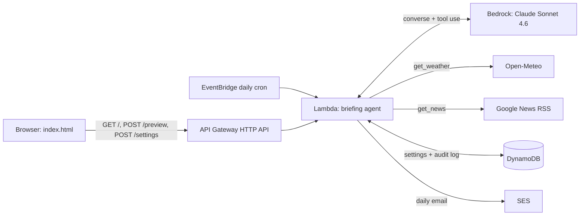
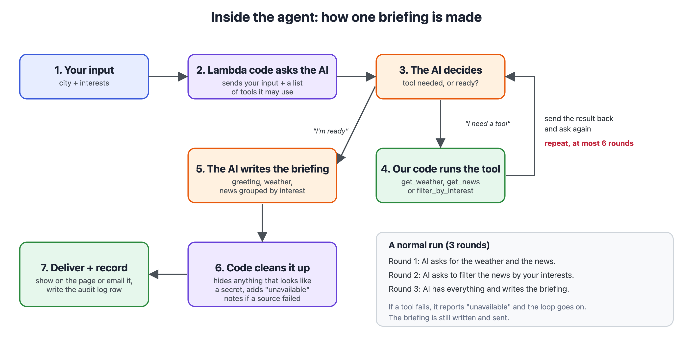
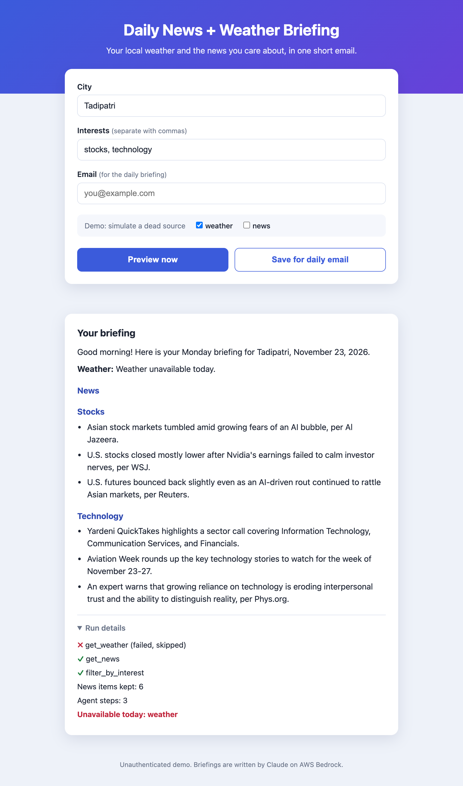

# Daily News + Weather Briefing

An AWS agent that emails a short morning briefing: real local weather plus news on your interests, grouped by interest. A web page lets you set your city, interests and email, and has a **Preview now** button that shows the briefing immediately, with a **Run details** box (tools used, items kept, skipped sources).

Spec: [`docs/project-spec.md`](docs/project-spec.md) · Owner: Siva Yerasi

## How it works


The same picture as a GitHub-rendered diagram:



One Lambda (Python 3.13) runs a single-agent loop with Bedrock `converse()`. Claude calls three tools:

| Tool | What it does | Source |
|---|---|---|
| `get_weather(city)` | Current conditions and a 3-day forecast | Open-Meteo (real) |
| `get_news(topics)` | Up to 3 recent headlines per topic (last 24 hours), newest first | Google News RSS (real, no API key) |
| `filter_by_interest(items, interests)` | Keeps items that match an interest | Keyword match |

Then Claude writes the briefing: a greeting, a weather paragraph, and a news section with one heading per interest.

Inside one run, the Lambda code and the AI take turns. The AI asks for a tool, the code runs it and sends the result back, and this repeats (at most 6 rounds) until the AI writes the briefing:



**Behavior worth knowing**
- **City lookup:** Open-Meteo first, then OpenStreetMap Nominatim for spellings it misses (for example Tadipatri is stored as Tadpatri).
- **News edition:** picked from the city's country (an Indian city gets the India edition), with the US edition as a fallback.
- **News retry:** if a topic's request fails or comes back empty, it is retried once after a short pause.
- **Interests:** separate with commas. Words without a comma count as one interest, so `stock market` stays one interest. The page warns if you type several words with no comma.
- **Email:** sent as HTML (bold headings, bullet lists) with a plain-text fallback.
- **Settings:** one saved setting per email address. Saving again with the same email overwrites it.

## Reliability and guardrails

| Pattern | What it does | Where |
|---|---|---|
| Max iterations | The agent loop stops after 6 model calls (a normal run uses 3). If it never finishes, the briefing says it could not be completed. | `agent.py` `MAX_ITERATIONS` |
| Error recovery | Tools return `unavailable: true` instead of raising. The agent skips that source, and code adds "Weather/News unavailable today" if the model omits it. One failed topic or one failed user does not stop the rest. | `tools.py`, `agent.py`, `handler.py` |
| Input guardrail | City: letters and simple punctuation, up to 80 characters. Interests: 1 to 10, up to 40 characters each, no special symbols. Email must look valid. Bad input gets HTTP 400 and the model is never called. News text is treated as data, not instructions. | `guardrails.py`, system prompt |
| Output guardrail | Credential-like text (AWS keys, `password=...`, long random strings) is replaced with `[redacted]` before display or email. | `guardrails.scrub_output` |
| Audit log | Every run writes one DynamoDB row: trigger, city, interests, tools called and whether each worked, items kept, unavailable sources, agent steps, email status and the briefing. Rows expire after 90 days. | `store.py` |

A real sample row is in [`docs/audit-log-sample.json`](docs/audit-log-sample.json). It is from the daily-email code path, triggered by hand, with the email address masked.

To demo a dead source, tick "weather" or "news" under "Demo: simulate a dead source" on the page, then press Preview now.

## Screenshots

Normal briefing, all sources worked:


Weather source skipped (simulated). The briefing still arrives with "Weather unavailable today":



## API

All routes are served by the same Lambda, so the page and the API share one URL (the `ApiUrl` stack output).

| Route | Purpose | Body (JSON) |
|---|---|---|
| `GET /` | The web page | none |
| `POST /preview` | Run the agent now and return the briefing | `city`, `interests`, optional `email`, optional `simulate_failure` (`["weather"]`, `["news"]`) |
| `POST /settings` | Save city, interests and email for the daily email | `city`, `interests`, `email` |

`/preview` returns `briefing`, `gaps`, `iterations`, `sources` and `items_kept`. Errors return HTTP 400 (bad input) or 500, with an `error` message.

## AWS resources

Stack name `news-weather-briefing`, region `us-east-1`.

| Resource | Name | Notes |
|---|---|---|
| Lambda | `news-weather-briefing-agent` | 256 MB, 120 s timeout |
| API Gateway HTTP API | `news-weather-briefing-api` | Unauthenticated (demo) |
| DynamoDB table | `news-weather-briefing-table` | On-demand. Keys: `pk` = `USER#<email>`, `sk` = `SETTINGS` or `AUDIT#<timestamp>`. TTL on `expires_at` (audit rows). Deleted with the stack. |
| EventBridge rule | `news-weather-briefing-daily` | Default 01:30 UTC = 7:00 AM IST |
| IAM role (Lambda) | auto-named | DynamoDB read/write on its own table, `bedrock:InvokeModel` on Claude Sonnet 4.6 only (this action also authorizes `converse()`), `ses:SendEmail` |

Model: `us.anthropic.claude-sonnet-4-6`. No API keys are used: Bedrock is called through the Lambda's IAM role.

## Project layout

```
app.py, cdk.json           CDK entry point and settings (sender email, schedule time)
infra/stack.py             AWS resources
lambda/briefing/           Lambda code
  handler.py                 routes, daily run, email sending (HTML + text)
  agent.py                   Bedrock converse() tool-use loop
  tools.py                   get_weather, get_news, filter_by_interest
  guardrails.py              input validation, output scrubbing
  store.py                   DynamoDB settings and audit log
  index.html                 the web page (plain HTML, CSS and JavaScript)
tests/test_briefing.py     40 unit tests (no AWS needed)
docs/                      project spec, sample audit log, screenshots, diagrams (PNG + SVG)
```

## Run the tests

```
python3 -m venv .venv && .venv/bin/pip install -r requirements.txt
.venv/bin/python -m pytest
```

## Deploy

Prerequisites: AWS credentials for the target account (for example `export AWS_PROFILE=<profile>`), the CDK CLI, a bootstrapped account (`cdk bootstrap`), and Bedrock access to Claude Sonnet 4.6 in `us-east-1`.

1. **Verify email addresses in SES.** SES is in sandbox mode, so the sender and every recipient must be verified. For each address:
   ```
   aws ses verify-email-identity --email-address you@example.com --region us-east-1
   ```
   Then click the link AWS emails you.
2. **Set the sender and time** in `cdk.json`: `sender_email` (must be a verified address), `schedule_hour_utc` and `schedule_minute_utc`. They can also be passed with `-c`, for example `cdk deploy -c sender_email=you@example.com`.
3. **Deploy:**
   ```
   cdk deploy
   ```
4. Open the `ApiUrl` output, enter a city and interests, and press Preview now. Press "Save for daily email" to receive the daily email.

**Changing the send time:** the schedule is in UTC. India is UTC+5:30, so 7:00 AM IST is 01:30 UTC. Edit `cdk.json` and run `cdk deploy` again.

**Test the email without waiting for the schedule:**
```
aws lambda invoke --function-name news-weather-briefing-agent \
  --cli-binary-format raw-in-base64-out --payload '{"source":"aws.events"}' out.json
```
This emails every saved user.

**Troubleshooting**
- `cdk deploy` says credentials are expired but `aws sts get-caller-identity` works (SSO login): run `eval "$(aws configure export-credentials --profile <profile> --format env)"` first.
- Node 25 prints a large "untested Node version" warning. It is harmless. Silence it with `export JSII_SILENCE_WARNING_UNTESTED_NODE_VERSION=1`.
- The email is missing: check the Spam folder. Mail from a gmail.com sender sent through SES has no DKIM signature, so Gmail often filters the first one. Mark it "Not spam".

## Clean up

```
cdk destroy
```

This removes every resource above, including the DynamoDB table and its saved settings and audit logs.

## Limitations

- The page and API have no login, so anyone with the URL can run a preview (each preview costs a small Bedrock charge). It is a demo.
- News comes from headlines only. Google News RSS has no summaries, and a general search can return loosely related stories.
- The daily run scans the whole table for saved settings, which is fine for a demo but not for many users.
- SES sandbox: only verified addresses can receive email.
- Tools use Python's built-in `urllib` instead of `httpx`, so the Lambda needs no bundled packages. The web requests are the same.
- The page is served by the Lambda. Hosting `index.html` on S3 (the spec's stretch goal) was not done.
