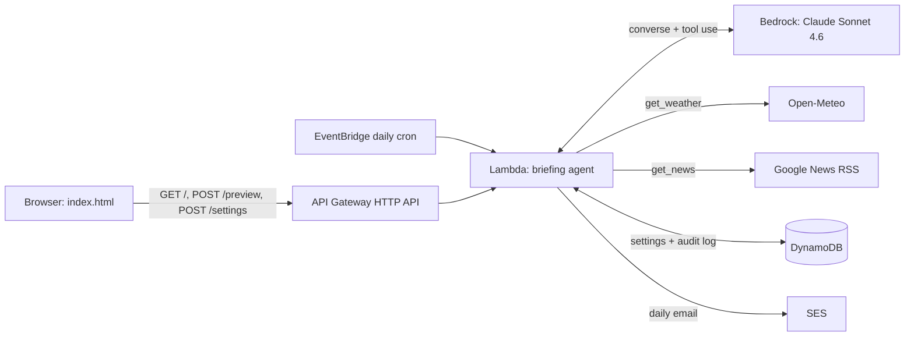

# Daily News + Weather Briefing

An AWS agent that emails a short morning briefing (local weather plus news on your interests, grouped by interest). A web page has a "Preview now" button that shows the briefing right away, with a "Run details" box (tools used, items kept, skipped sources). Spec: `docs/project-spec.md`.

## Architecture



One Lambda runs a single-agent loop. Claude calls three tools: `get_weather` (Open-Meteo, real), `get_news` (Google News RSS, real, no API key), `filter_by_interest` (keyword match).

- **City lookup:** Open-Meteo first, then OpenStreetMap Nominatim for spellings it misses (for example Tadipatri).
- **News edition:** chosen from the city's country (India city gets the India edition), falling back to the US edition.
- **News retry:** if a topic's feed fails or comes back empty, it is retried once after a short pause before giving up on that topic.
- **Interests:** separate with commas. Words without a comma count as one interest, so `stock market` stays one interest.
- **Email:** sent as HTML (headings and bullets) with a plain-text fallback.

## Reliability and guardrails

| Pattern | Where |
|---|---|
| Max iterations (default 6) | `agent.py` `MAX_ITERATIONS` |
| Error recovery | Tools return `unavailable: true` instead of raising. The agent skips that source and the code appends "Weather/News unavailable today" if the model omits it. |
| Input guardrail | `guardrails.py` validates city, interests (max 10) and email |
| Output guardrail | `scrub_output` redacts credential-like strings |
| Audit log | Each run writes sources, items kept, gaps and the briefing to DynamoDB (90-day TTL) |

Sample record: `docs/audit-log-sample.json` (one real scheduled run, email address masked).

Demo a dead source: tick "weather" or "news" under "simulate a dead source" on the page, then press Preview.

## Screenshots

Normal briefing, all sources worked:


Weather source skipped (simulated). The briefing still arrives with "Weather unavailable today":


## Layout

```
app.py, cdk.json           CDK entry point and settings (sender email, schedule time)
infra/stack.py             AWS resources (Lambda, API, DynamoDB, EventBridge, IAM)
lambda/briefing/           Lambda code
  handler.py                 routes, email sending (HTML + text)
  agent.py                   Bedrock converse() tool-use loop
  tools.py                   get_weather, get_news, filter_by_interest
  guardrails.py              input validation, output scrubbing
  store.py                   DynamoDB settings and audit log
  index.html                 the web page
tests/test_briefing.py     unit tests (no AWS needed)
docs/                      project spec, sample audit log, screenshots
```

## Run the tests

```
python3 -m venv .venv && .venv/bin/pip install -r requirements.txt
.venv/bin/python -m pytest -q tests
```

## Deploy

Prerequisites: AWS credentials (for example `export AWS_PROFILE=<profile>`), region `us-east-1`, the CDK CLI, a bootstrapped account (`cdk bootstrap`), and Bedrock access to Claude Sonnet 4.6.

```
cdk deploy -c sender_email=you@example.com
```

- `sender_email` (set in `cdk.json`) must be a verified SES identity. SES is in sandbox mode, so every recipient must be verified too. For each address run `aws ses verify-email-identity --email-address you@example.com --region us-east-1`, then click the link AWS emails you.
- Mail from a gmail.com sender can land in Spam (no DKIM). Mark it "Not spam" once.
- Trigger the daily run by hand to test email: `aws lambda invoke --function-name news-weather-briefing-agent --cli-binary-format raw-in-base64-out --payload '{"source":"aws.events"}' out.json`.
- The daily send time is `schedule_hour_utc` and `schedule_minute_utc` in `cdk.json` (UTC). Default is 01:30 UTC, which is 7:00 AM IST. Override with `-c schedule_hour_utc=N -c schedule_minute_utc=M`.
- If `cdk deploy` says credentials are expired but `aws sts get-caller-identity` works (SSO login), run `eval "$(aws configure export-credentials --profile <profile> --format env)"` first.
- The stack output `ApiUrl` is the page URL. The page is unauthenticated (demo only).

Delete everything with `cdk destroy`. The table is removed with the stack.

## Notes

- Tools use `urllib` from the standard library, so the Lambda needs no bundled dependencies.
- `get_news` reads Google News RSS (up to 5 topics, 3 headlines each, last 24 hours). Headlines have no summaries. If every topic fails, the source is reported as unavailable.
